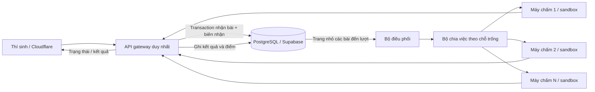

# Vận hành nhiều máy chấm

Cập nhật 21/10/2026. Tài liệu mô tả mã nguồn và cấu hình triển khai; không có nghĩa các máy AWS đã được tạo hoặc cập nhật.

## Luồng xử lý



- Vòng loại trả HTTP 202 sau khi lưu nguyên tử bài, công việc và biên nhận. Đây là xác nhận đã nhận bài, chưa phải kết quả hợp lệ.
- Thí sinh có thể mất kết nối sau khi gửi; gửi lại cùng mã yêu cầu không tạo bài mới. Bài đã nhận trước hạn vẫn được chấm sau hạn.
- Hàng đợi lấy tối đa 128 công việc/lần, bỏ qua bài đang chờ thử lại, không tải mã nguồn hoặc lịch sử đã hoàn tất trong bước lấy việc.
- Mỗi máy nhận tối đa `WORKER_CONCURRENCY` tác vụ. Gateway chờ chỗ trống; worker có giới hạn riêng và trả 429 nếu bị gửi quá tải.
- Máy không kết nối được, quá thời gian, trả 429/5xx hoặc sai phiên bản sẽ được bỏ qua khi có máy khác. Máy lỗi bị nghỉ 2 giây trước khi được chọn lại.
- Chấm lại có thể chạy mã thêm một lần; kết quả chỉ được ghi bởi gateway. Vòng ELO được ghi nguyên tử, các trận DONE không chạy lại khi phục hồi.
- Gateway khởi động lại sẽ lấy công việc chưa hoàn tất từ database. Không giữ kết nối SQL suốt thời gian chạy sandbox.
- Chỉ tăng số **máy chấm**, không chạy thêm API gateway ghi dữ liệu. Snapshot bảng đấu hiện tại dùng cache và có khóa singleton PostgreSQL. Tắt gateway Render/phiên bản cũ trước khi tổ chức thi.

## Cấu hình gateway và máy chấm

Giữ frontend Cloudflare và Supabase hiện có. Đặt các máy chấm cùng mạng riêng với gateway; firewall/Security Group chỉ cho phép gateway truy cập TCP 8001. Không mở cổng chấm ra Internet. Worker không cần mật khẩu Supabase hay tài khoản admin.

Ví dụ 4 máy, mỗi máy cho phép 2 tác vụ:

```dotenv
WORKER_URLS=http://10.0.1.10:8001/mutate-tournament,http://10.0.1.11:8001/mutate-tournament,http://10.0.1.12:8001/mutate-tournament,http://10.0.1.13:8001/mutate-tournament
WORKER_TOKEN=<cùng khóa bí mật trên gateway và các máy chấm>
WORKER_RELEASE=<cùng commit đã triển khai>
WORKER_CONCURRENCY=2
JUDGE_CONCURRENCY=8
VALIDATION_WORKERS=4
QUALIFIER_WORKERS=8
WORKER_ATTEMPT_TIMEOUT_SECONDS=90
```

`JUDGE_CONCURRENCY` giới hạn tổng mọi tác vụ chấm, gồm chạy thử, kiểm tra mã và đấu. Không cộng các giới hạn để suy ra số tác vụ thực tế. Số máy × giới hạn mỗi máy là trần bổ sung. Giới hạn tổng tối đa 32; mỗi máy tối đa 8. Máy EC2 nhỏ hiện tại nên giữ cấu hình thấp cho tới khi chuyển phần thực thi sang các máy riêng.

Trên từng máy chấm:

1. Checkout đúng commit, có Docker Compose và Linux hỗ trợ Landlock/seccomp. Khởi động production sẽ từ chối chạy nếu thiếu cách ly Python.
2. Sao chép `deploy/judge.env.example` tới `/etc/arena/judge.env`, đặt quyền 600. Điền private IP của máy, token chung, `WORKER_CAPACITY` bằng `WORKER_CONCURRENCY`, `ARENA_RELEASE` bằng commit thực tế. Không commit file bí mật.
3. Chạy từ thư mục dự án:

```sh
docker compose --env-file /etc/arena/judge.env -f deploy/judge-compose.yml up -d --build
docker compose --env-file /etc/arena/judge.env -f deploy/judge-compose.yml ps
```

Compose đặt filesystem chỉ đọc, bỏ Linux capabilities, giới hạn RAM/CPU/PID và xoay log. Cấu hình mẫu dành 2 CPU, tối đa 1.5 GiB RAM cho container; đây là giới hạn cấu hình, chưa phải cam kết đủ cho mọi bot. Chọn máy và số tác vụ theo đo tải thực tế. Dùng cùng image digest cho mọi máy khi phát hành chính thức; nhãn commit tự khai không thay thế việc kiểm tra image.

Sau đó cập nhật môi trường gateway và khởi động lại gateway ngoài giờ thi. `/ready` kiểm tra toàn bộ worker; một máy lỗi làm readiness đỏ dù pool vẫn có thể chấm bằng máy còn lại. `/health` chỉ phản ánh API còn hoạt động. Không tự khởi động lại cả hệ thống chỉ vì một worker mất readiness.

## Dữ liệu và bộ nhớ

| Dữ liệu | Cách sử dụng |
|---|---|
| Mã nguồn các bài đã nhận + mã biên nhận | Giữ để phục hồi, đối chiếu bài đúng hạn và xử lý khiếu nại |
| Bài hợp lệ đang chọn của đội | Giữ bản tương thích trong participant; chưa xóa nguồn cũ hoặc tự migration dữ liệu |
| Task validation | Metadata nhỏ, có trạng thái và giờ thử lại; index riêng chỉ bao phủ task đang chờ |
| Trận vòng loại | Giữ đội, seed, kết quả, số lần thử và ELO trước/sau; không lưu toàn bộ bàn cờ từng nước |
| Lịch sử bảng đấu chính | Giữ replay phục vụ xem lại; tách biệt vòng loại |
| Log thực thi, cache và mã đã biên dịch | Không coi là nguồn dữ liệu chính; không ghi bí mật hoặc toàn bộ mã vào log |

Ghép cặp, khóa bài, gia hạn và tính ELO đọc metadata thay vì mã toàn bộ thí sinh. Khi chấm, chỉ tải mã hai đội của trận đó. PostgreSQL giữ nguyên trường code tại chỗ khi cập nhật điểm, giảm bộ nhớ gateway và lưu lượng SQL. Trình tự ELO vẫn dựa trên điểm đầu lượt, không phụ thuộc máy nào hoàn tất trước.

Không xóa lịch sử tự động khi đang thi. Sau thời hạn khiếu nại do ban tổ chức quy định: backup, kiểm tra restore, rồi mới thực hiện kế hoạch lưu trữ/xóa có kiểm soát. Code hiện còn dùng JSONB và giữ nguồn tương thích; chưa phải schema chuẩn hóa hoàn toàn hay lưu trữ không giới hạn. Với 4.000 bài × 64 KiB, riêng một lần nộp có thể xấp xỉ 250 MiB mã nguồn, chưa tính bản tương thích, JSONB, index và các lần nộp tiếp theo.

## Đo số máy cần dùng

Không thể bảo đảm hàng nghìn bài có kết quả tức thì chỉ bằng thêm máy. Đo cả Python/C++, mã tốt, mã lỗi và mã hết thời gian trong sandbox:

```text
Thông lượng xấp xỉ = số tác vụ chạy đồng thời / thời gian trung bình một tác vụ
Thời gian xử lý một đợt xấp xỉ = số tác vụ × thời gian trung bình / số tác vụ đồng thời
```

Ví dụ toán học: 4.000 bài, trung bình 2 giây, 16 chỗ chấm → khoảng 500 giây để hết đợt, chưa tính retry/biên dịch/SQL. Đây không phải số đo của hệ thống.

Dùng `tests/load/qualifier_submissions.py` trên staging, tăng dần số tài khoản và concurrency. Đo p95 thời gian nhận biên nhận, p95 chờ kết quả, CPU/RAM từng worker, kết nối SQL, lỗi 429/5xx và dung lượng DB. Không chạy tải vào giải thật. Mục tiêu nghiệm thu do ban tổ chức chọn phải đạt trên đúng cấu hình và bộ bot dự kiến.

## Xử lý sự cố và giới hạn

| Tình huống | Hành vi / thao tác |
|---|---|
| Một worker chết hoặc bận | Gateway chọn máy khác; bài validation chưa có kết quả giữ trạng thái chờ |
| Tất cả worker chết | Vẫn nhận và lưu bài vòng loại trong giới hạn hàng đợi; không đánh trượt vì lỗi hạ tầng |
| Gateway mất điện | Bài đã commit còn trong PostgreSQL; khi gateway khởi động lại, phục hồi công việc và biên nhận |
| Database không truy cập được | Không báo đã nhận thành công; frontend giữ outbox để gửi lại |
| Máy thí sinh mất mạng | Bài đã lưu trong trình duyệt chờ đồng bộ; không thể chạy boss/chấm server khi mất mạng |
| Mất mạng tới quá hạn | Không tin giờ trên máy thí sinh để tự cho nộp muộn; admin gia hạn công khai trước khi giải đã chạy |
| Trận thất bại nhiều lần | Giải tạm dừng, sửa worker rồi tiếp tục; không tự coi đội là thua vì lỗi đường truyền |
| Worker sai phiên bản | Từ chối kết quả nếu đã đặt `WORKER_RELEASE`; sửa về đúng image trước khi tiếp tục |

Luồng bảng đấu chính vẫn có các thao tác chấm đồng bộ; thay đổi này không biến mọi endpoint thành hàng đợi phân tán. Một gateway hiện còn là điểm gián đoạn tạm thời; cần máy dự phòng và quy trình chuyển quyền có kiểm soát, không bật hai writer. Backup ngoài máy, cảnh báo vận hành, diễn tập khôi phục và kiểm thử tải AWS vẫn là điều kiện trước giải thật. Không có cam kết xử lý mọi sự cố hay 4.000 người đồng thời khi chưa đo trên hạ tầng tương ứng.
